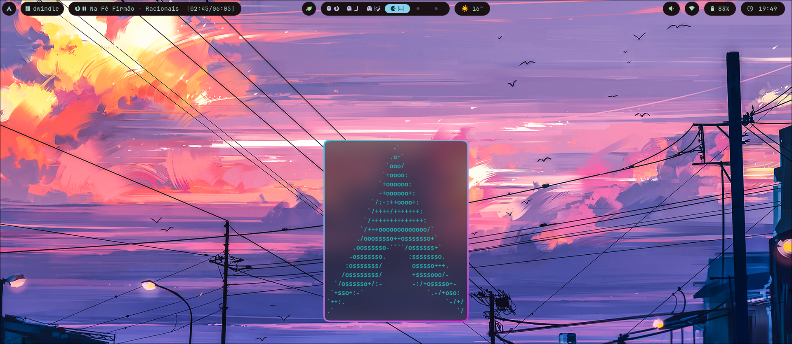
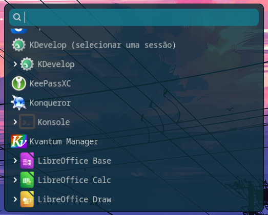
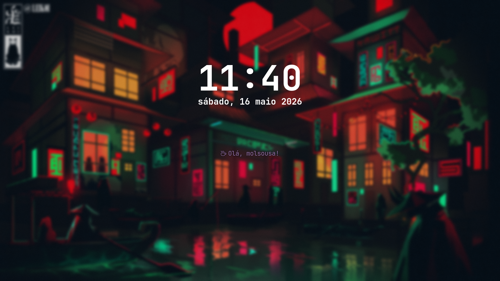
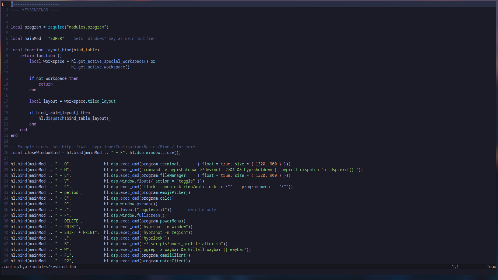

## .files para [](#) no [](#)

Mistura de outros dotfiles com personalizações.

### [Waybar](https://github.com/haikal-hakim/athena/tree/main/.config/waybar)



### Wofi



### Terminal


### [Hyprlock](https://github.com/MrVivekRajan/Hyprlock-Styles/tree/main/Style-9)



### [Neovim](https://github.com/folke/tokyonight.nvim)


## Plugins 

- ### [hyprland-scroll-overview](https://github.com/yayuuu/hyprland-scroll-overview)

Plugin para ter uma visão dos espaços de trabalhos em forma de 'scroll'.

- ### [split-monitor-workspaces](https://github.com/zjeffer/split-monitor-workspaces)

Plugin para separar espaços de trabalhos em diferentes monitores, pode ajudar em apresentações de slides!!

- ### [hypr-kinetic-scroll](https://github.com/savonovv/hypr-kinetic-scroll)

Plugin para melhorar funcionamento do scroll em touchpad.

## Hyprland

[Clique aqui para visualizar a divisão de arquivos das configurações definidas para o Hyprland](.config/hypr/modules/)

## Configuração do sistema

### AUR

```sh
sudo pacman -S --needed git base-devel

git clone https://aur.archlinux.org/yay.git

cd yay

makepkg -si
```

### Pacotes

- **Hyprpaper:** gerenciador de papel de parede.

- **Hyprlock:** gerenciador de tela de bloqueio.

- **Hyprshot:** aplicação pra captura de tela.

- **Wofi:** lançador de aplicativos.

- **Hyprpm:** utilitário para uso de plugins.

- **Thunar:** gerenciador de arquivos.

- **Waybar:** barra de tarefas.

- **Pipewire:** gerenciador de áudio.

- **Bluez:** gerenciador do bluetooth.

- **Polkit-Gnome:** autenticador do gnome.

- **Wofi-Calc:** calculadora.

- **Wofi-Emoji:** seletor de emojis.

```sh
sudo pacman -S hyprpaper

sudo pacman -S hyprlock

sudo pacman -S hyprshot

sudo pacman -S wofi

sudo pacman -S hyprpm

sudo pacman -S thunar thunar-archive-plugin

sudo pacman -S waybar

sudo pacman -S pipewire

sudo pacman -S bluez bluez-utils

sudo pacman -S polkit-gnome

yay -S wofi-calc wofi-emoji
```

### Fontes

```sh
sudo pacman -S noto-fonts noto-fonts-emoji noto-fonts-cjk

sudo pacman -S ttf-liberation

sudo pacman -S ttf-jetbrains-mono-nerd

yay -S otf-font-awesome

yay -S ttf-nerd-fonts-symbols

yay -S ttf-geist-mono
```

### Caso não tenha o terminal

Emulador de terminal acelerado por GPU.

```sh
sudo pacman -S alacritty
```

### Caso não tenha o zsh

Interpretador de comandos.

```sh
sudo pacman -S zsh

sudo pacman -S zsh-autosuggestions zsh-syntax-highlighting
```
